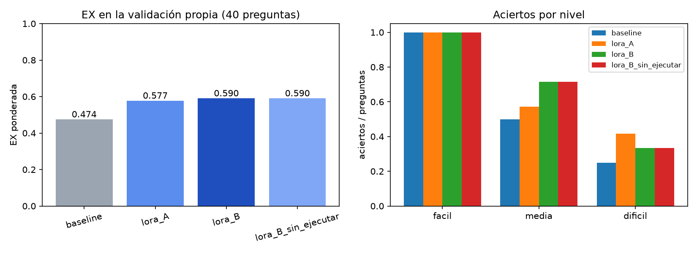
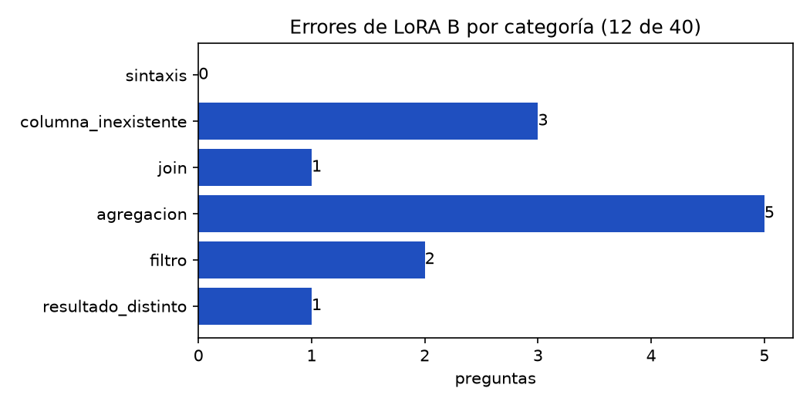

# Diapositivas 7–12 — Validación, errores y predicción de EX (Iris Ayala)

Contenido para las diapositivas de la presentación. Las imágenes están en `resultados/`.

---

## 7. Validación propia: dos esquemas no vistos

| | Gimnasio | Cooperativa de café |
|---|---|---|
| Tablas | 9 | 9 |
| Nombres | En español (`socios`, `membresias`, `asistencias`, `pagos`) | Abreviados (`prod`, `fca`, `lot`, `cat`, `vta_det`) |
| Datos | 2022–2025 | 2022–2025 |

- `COMMENT` en todas las tablas y columnas, como los entrega `SHOW CREATE TABLE`.
- Partición **por esquema**: ningún dominio aparece en el entrenamiento (`verificar_fuga.py`: sin fuga).
- El esquema abreviado imita lo que puede traer la evaluación oculta.

---

## 8. 40 preguntas y evaluador

| Nivel | Peso | Gimnasio | Café | Total |
|---|---|---|---|---|
| Fácil (una tabla) | 1 | 7 | 7 | 14 |
| Media (JOIN, GROUP BY, HAVING) | 2 | 7 | 7 | 14 |
| Difícil (subconsultas, WITH, ventana, fechas) | 3 | 6 | 6 | 12 |

`evaluar.py` imita al evaluador del docente:

- Compara por **ejecución**, no por texto.
- Números redondeados a 2 decimales; el orden solo cuenta si la pregunta lo pide; una columna extra no penaliza.
- `ejecutar(sql)` con usuario de solo lectura, máximo 3 llamadas.
- Más de 30 s o una salida que no sea SELECT/WITH cuenta como error.
- Prueba con las consultas de referencia: EX = 1.000.

---

## 9. Resultados: baseline vs. A vs. B

| Configuración | EX | Fáciles | Medias | Difíciles | Gimnasio | Café |
|---|---|---|---|---|---|---|
| Baseline (sin adapter) | 0.474 | 14/14 | 7/14 | 3/12 | 0.487 | 0.462 |
| LoRA A (atención) | 0.577 | 14/14 | 8/14 | 5/12 | 0.692 | 0.462 |
| **LoRA B (atención + MLP)** | **0.590** | 14/14 | 10/14 | 4/12 | 0.641 | 0.538 |

- **B es el adapter de la entrega**: mejora de **+0.116** sobre el baseline.
- Se confirma la hipótesis: B tiene menor loss en dev (0.0997 vs. 0.1174) y mayor EX.
- La ventaja de B está en las preguntas medias (10/14 vs. 8/14).

---

## 10. Experimento de inferencia: autocorrección con `ejecutar`

| LoRA B | EX | Errores de columna | Resultado distinto | Tiempo máx. |
|---|---|---|---|---|
| Con `ejecutar` (corrige con el error de MySQL) | 0.590 | 3 | 8 | 10.5 s |
| Sin `ejecutar` (una sola respuesta) | 0.590 | 4 | 7 | 3.3 s |

- La autocorrección arregló un error de columna, pero la consulta corregida devolvió un resultado distinto: **ganancia neta 0**.
- Los errores que quedan son **lógicos** (agregación, filtro): MySQL no marca error, así que no hay nada que corregir.
- Se mantiene la autocorrección en la entrega: no empeora y el tiempo queda lejos de 30 s.

---

## 11. Análisis de errores (LoRA B: 12 de 40)

| Categoría | Errores | Ejemplo |
|---|---|---|
| Agregación | 5 | Devuelve el salario más alto de toda la cadena en vez del más alto por sede |
| Columna inexistente | 3 | Inventa `fca.lot_id` y se salta la tabla intermedia `lot` |
| Filtro | 2 | Falta `estado = 'pagada'` |
| JOIN | 1 | Une productores y catación por el nombre del catador |
| Resultado distinto | 1 | Usa `DATEDIFF` (días) cuando se piden minutos |
| Sintaxis | **0** | — |

- **0 errores de sintaxis**: el modelo ya escribe MySQL válido.
- Los 3 errores de columna son del esquema abreviado: le cuesta seguir caminos de 3 tablas.
- 9 de los 12 errores son preguntas **difíciles**.

Detalle de cada error: `resultados/errores_lora_B.csv`.

---

## 12. Predicción de EX en la evaluación oculta

**Predicción: EX ≈ 0.55** (rango 0.48–0.62) con el adapter B.

| Evidencia | Valor |
|---|---|
| EX de B en la validación propia | 0.590 |
| EX de B en el esquema abreviado | 0.538 |
| Fáciles / medias / difíciles | 100 % / 71 % / 33 % |
| Mejora sobre el baseline | +0.116 |
| Tiempo máximo por pregunta | 10.5 s (límite 30 s) |

- La evaluación oculta puede traer nombres abreviados o en inglés, donde B rinde menos: por eso la predicción queda por debajo de 0.590.
- Las fáciles son estables; la variación viene de las difíciles (peso 3).
- Mejora esperada sobre el modelo sin adapter: **+0.10 a +0.12**.
